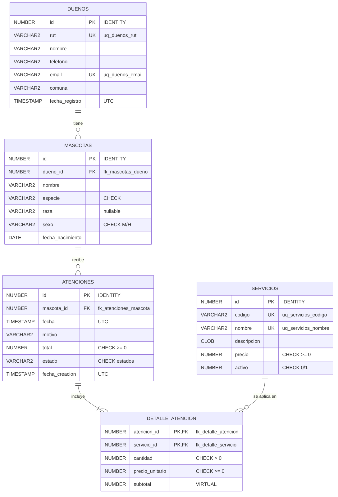

# Modelo de datos · Clínica veterinaria «Huellitas» (G02)



El código fuente del diagrama está en `modelo_datos.mmd` (Mermaid). Se puede editar en https://mermaid.live.

## Entidades y relaciones

| Relación | Cardinalidad | Clave foránea | Explicación |
|---|---|---|---|
| DUENOS → MASCOTAS | 1 : N (0..N) | `mascotas.dueno_id` → `fk_mascotas_dueno` | Un dueño puede tener cero o muchas mascotas; cada mascota tiene exactamente un dueño. |
| MASCOTAS → ATENCIONES | 1 : N (0..N) | `atenciones.mascota_id` → `fk_atenciones_mascota` | Una mascota puede tener muchas atenciones; cada atención es de una sola mascota. |
| ATENCIONES → DETALLE_ATENCION | 1 : N (1..N) | `detalle_atencion.atencion_id` → `fk_detalle_atencion` | Toda atención tiene al menos un servicio en su detalle. |
| SERVICIOS → DETALLE_ATENCION | 1 : N (0..N) | `detalle_atencion.servicio_id` → `fk_detalle_servicio` | Un servicio puede aparecer en muchas atenciones. |

La relación entre ATENCIONES y SERVICIOS es de muchos a muchos y se resuelve con la tabla de detalle **DETALLE_ATENCION**, cuya clave primaria es compuesta (`atencion_id`, `servicio_id`). Esa tabla también guarda el precio cobrado en ese momento (`precio_unitario`), para que un cambio de precio futuro no altere las atenciones antiguas, y tiene la columna virtual `subtotal = cantidad × precio_unitario` calculada por Oracle.

## Entidad principal y estados

La entidad principal es **ATENCIONES**. Sus estados y transiciones permitidas son:

```
agendada ──► realizada ──► pagada
    │
    └──────► cancelada
```

`pagada` y `cancelada` son estados finales. Solo una atención `agendada` se puede editar o eliminar.

## Restricciones exigidas por el enunciado

| Exigencia | Cumplimiento |
|---|---|
| Al menos 3 claves foráneas | 4: `fk_mascotas_dueno`, `fk_atenciones_mascota`, `fk_detalle_atencion`, `fk_detalle_servicio` |
| Al menos 2 UNIQUE | 4: `uq_duenos_rut`, `uq_duenos_email`, `uq_servicios_codigo`, `uq_servicios_nombre` |
| Al menos 3 CHECK | 10: email, especie, sexo, precio, activo, total, estado, cantidad, precio unitario |
| Tabla de detalle con PK compuesta | `pk_detalle_atencion (atencion_id, servicio_id)` |
| Columna virtual | `detalle_atencion.subtotal` |
| Índice por cada FK | `idx_mascotas_dueno`, `idx_atenciones_mascota`, `idx_detalle_atencion`, `idx_detalle_servicio` |
| Fechas en UTC | `DEFAULT SYS_EXTRACT_UTC(SYSTIMESTAMP)` y Django con `USE_TZ = True` |
